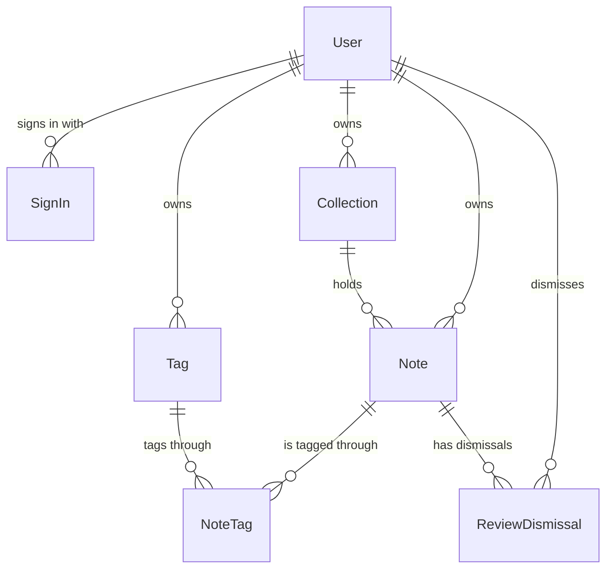

# Domain model

The model as a whole: which entities the app stores and how they relate. The attributes, validations, and rules of each entity are in the area file that names it, so each fact is in one place. Each relation below is a foreign key of `backend/db/schema.rb`, and the "many" side is the table that holds the key. (AC-28)

Every record belongs to one user, and a user sees only their own (AC-21). A note is in exactly one collection. A note and a tag are many to many, through `NoteTag`. Deleting a note deletes its `NoteTag` and `ReviewDismissal` rows, and deleting a tag deletes its `NoteTag` rows. A collection is deleted only when it holds no notes (AC-07).

## Areas

- [users](users.md): `User` and `SignIn`, the account and the browsers it is signed in on (AC-01 to AC-05).
- [collections](collections.md): `Collection`, a named group of notes (AC-06, AC-07).
- [tags](tags.md): `Tag`, a label the user makes and puts on notes (AC-08).
- [notes](notes.md): `Note`, with its collection, status, and source, and `NoteTag`, its links to tags (AC-09 to AC-11, AC-17).
- [reviews](reviews.md): the review schedule, the last review date, and the due, overdue, and no-reminder rules; they are fields and states of notes, so this area has no entity of its own (AC-12 to AC-19).
- [notifications](notifications.md): `ReviewDismissal`, the dismissal of one reminder, and the reminder and batch messages, which are sent and not stored (AC-20, AC-23).
